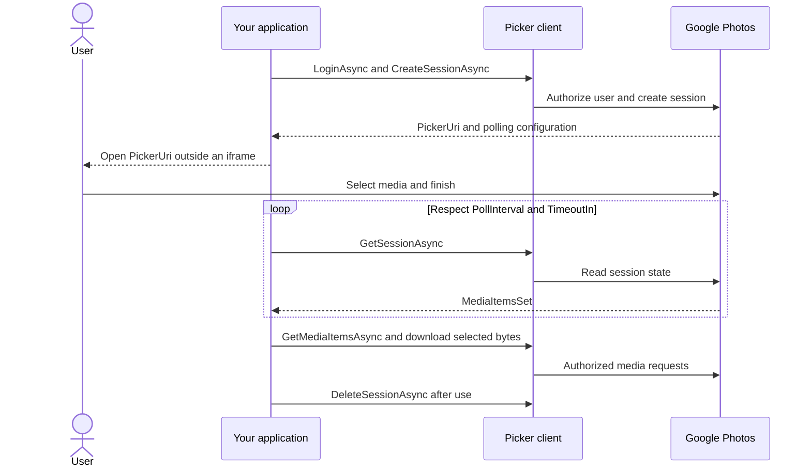

# CasCap.Api.GooglePhotos

CasCap.Api.GooglePhotos is an unofficial .NET 10 client for the Google Photos Library API and Picker API.

[CasCap.Api.GooglePhotos-badge]: https://img.shields.io/nuget/v/CasCap.Api.GooglePhotos?color=blue
[CasCap.Api.GooglePhotos-url]: https://nuget.org/packages/CasCap.Api.GooglePhotos

[](https://github.com/f2calv/CasCap.Api.GooglePhotos/actions/workflows/ci.yml)

## Projects

| Documentation | Purpose | Published package |
| --- | --- | --- |
| [CasCap.Api.GooglePhotos](src/CasCap.Api.GooglePhotos/README.md) | Library and Picker clients, OAuth and validated options | [![NuGet version][CasCap.Api.GooglePhotos-badge]][CasCap.Api.GooglePhotos-url] |
| [ConsoleApp](samples/ConsoleApp/README.md) | Direct construction without DI or resilience handlers | Not packaged |
| [GenericHost](samples/GenericHost/README.md) | Configuration, dependency injection and a one-shot upload worker | Not packaged |
| [CasCap.Api.GooglePhotos.Tests](src/CasCap.Api.GooglePhotos.Tests/README.md) | Offline unit tests and credentialed integration tests | Not packaged |

Samples and integration tests can create albums and upload media. Review their prerequisites and
side effects before executing them; use a dedicated account and synthetic media.

## Important: Google changed the Photos APIs on 31 March 2025

Google fundamentally reduced what any third-party application can do with a user's Google Photos library. This is not a limitation of this library; it applies to every client of the Photos APIs:

* The Library API can manage **only albums and media items created by your own application**. Everything already in the user's account is invisible to it.
* Reading an entire library, and therefore whole-library search, backup or duplicate detection, is no longer possible.
* Library API sharing and shared-album operations were withdrawn entirely, along with their scopes.
* Existing user media can only be reached through the Picker API, which requires the user to select items interactively, one session at a time.

Applications that previously listed a user's complete library must migrate that workflow to the Picker API. See [Google's API update](https://developers.google.com/photos/support/updates) and issue [#208](https://github.com/f2calv/CasCap.Api.GooglePhotos/issues/208).

API access and authorization guidance checked against Google's documentation on **20 October 2026**.
This is a documentation verification date, not a live-service test result.

The [`googlephotos` CLI](https://github.com/f2calv/CasCap.GooglePhotosCli) built on this library is constrained in exactly the same way.

## Migrating to v4

Version 4 is a breaking release:

* The library targets .NET 10 only.
* Public DTO properties and enum members use PascalCase while preserving Google's JSON wire names.
* Removed Google sharing APIs and scopes are no longer exposed. `ShareInfo`, `SharedAlbumOptions` and `ContributorInfo`, along with `Album.ShareInfo` and `MediaItem.ContributorInfo`, are gone because no remaining scope can populate them.
* Library API operations now apply only to content created by the configured OAuth client.
* `UploadSingle`, `UploadMultiple` and `DownloadBytes` are renamed to `UploadSingleAsync`, `UploadMultipleAsync` and `DownloadBytesAsync`.
* OAuth cache entries are isolated by local user, OAuth client ID, and requested scopes.
* Authorization moved to the shared `GooglePhotosCredentialProvider` and is applied per request. The `LoginAsync` overloads that took OAuth settings or a `GooglePhotosOptions` instance are removed; configure options through `AddGooglePhotos` and call `LoginAsync(cancellationToken)`.

Applications that need existing user media must use `GooglePhotosPickerService`. Recompile consumers and update renamed DTO members before upgrading.

## Installation

```powershell
dotnet package add CasCap.Api.GooglePhotos
dotnet package add Microsoft.Extensions.Hosting
```

## Quick Start

### Configure Google Cloud

1. Create or select a project in the [Google Cloud Console](https://console.cloud.google.com/).
2. Open **APIs & Services > Library**, search for "Photos", and enable **Google Photos Library API** if the application creates or manages app-created media and albums.
3. Enable **Google Photos Picker API** if the application lets users select existing media. Do not enable **Google Picker API** by mistake; it is a different product.
4. Open **Google Auth Platform**, configure the consent screen, select an audience, and declare the required Photos scopes under **Data Access**.
5. If the app has an external audience and remains in testing, add each Google account that will run it as a test user.
6. Open **APIs & Services > Credentials**, create an **OAuth client ID**, and choose **Desktop app**. This library uses Google's installed-application loopback flow.
7. Record the client ID and client secret in a secret store. Never place them in source control or tracked configuration.

The Google Photos APIs require an authenticated Google user and do not support service accounts.
Public applications requesting sensitive Photos scopes must meet Google's
[OAuth verification requirements](https://developers.google.com/identity/protocols/oauth2/production-readiness/sensitive-scope-verification),
subject to its documented exceptions. Keep the OAuth client ID stable because Google associates
API-created resources with the client that created them.

### Configure the application

Register the clients through standard .NET configuration and dependency injection:

```csharp
using Microsoft.Extensions.DependencyInjection;
using Microsoft.Extensions.Hosting;

var builder = Host.CreateApplicationBuilder(args);

builder.Services.AddGooglePhotos(builder.Configuration);

using var host = builder.Build();
var photos = host.Services.GetRequiredService<CasCap.Services.GooglePhotosService>();
if (!await photos.LoginAsync())
    throw new InvalidOperationException("Google Photos authentication failed.");
```

Registration alone does not perform an operation. Use the resolved client with the
[Library API example](#library-api), or resolve `GooglePhotosPickerService` for the
[Picker flow](#picker-api).

For local development, initialize User Secrets in the consuming application project and store credentials there:

```powershell
$env:DOTNET_ENVIRONMENT = "Development"
dotnet user-secrets init
dotnet user-secrets set "CasCap:GooglePhotosOptions:User" "local-user"
dotnet user-secrets set "CasCap:GooglePhotosOptions:ClientId" "your-client-id"
dotnet user-secrets set "CasCap:GooglePhotosOptions:ClientSecret" "your-client-secret"
```

`User` is a local token-cache key. It identifies the cached grant on this machine and does not need to be the Google account's email address.

The first call to `LoginAsync` opens the system browser for consent. Cached grants are separated by user and requested scope set. If a user declines a required scope, revoke or remove that cached grant and authenticate again. For an external consent screen in testing, Google can expire refresh tokens after seven days, so repeated authentication during development is expected.

`AddGooglePhotos` registers a singleton [`GooglePhotosCredentialProvider`](https://github.com/f2calv/CasCap.Api.GooglePhotos/blob/ec3cee350804e73cd48461c1a2df063ad14c686e/src/CasCap.Api.GooglePhotos/Services/GooglePhotosCredentialProvider.cs). Authorizing through either client stores the grant there, so one `LoginAsync` call covers the Library API client, the Picker API client, and every later resolution of them. A delegating handler reads the provider on each request, so an expiring access token is refreshed automatically rather than being captured once at login.

## OAuth Scopes

| Enum value                       | Google scope                                       | Capability                                        |
| -------------------------------- | -------------------------------------------------- | ------------------------------------------------- |
| `AppendOnly`                     | `photoslibrary.appendonly`                         | Create media, albums, and enrichments             |
| `ReadOnlyAppCreatedData`         | `photoslibrary.readonly.appcreateddata`            | Read media and albums created by the application  |
| `EditAppCreatedData`             | `photoslibrary.edit.appcreateddata`                | Edit and organize application-created content     |
| `PickerMediaItemsReadOnly`       | `photospicker.mediaitems.readonly`                 | Create Picker sessions and read selected media    |

Request only the scopes needed by the application. The library creates a separate cached grant when the requested scope set changes.

## Configuration Examples

Tracked settings must contain placeholders only. Store credentials with .NET User Secrets locally and
environment variables or secret-backed providers in deployed environments. For the Library upload
example, start with:

```json
{
  "CasCap": {
    "GooglePhotosOptions": {
      "User": "local-user",
      "Scopes": ["AppendOnly", "ReadOnlyAppCreatedData"],
      "ClientId": "your-client-id",
      "ClientSecret": "your-client-secret"
    }
  }
}
```

Environment variables use the standard double-underscore form, for example `CasCap__GooglePhotosOptions__ClientId`.

For a Picker-only application, replace `Scopes` with `["PickerMediaItemsReadOnly"]`.
The [package README](src/CasCap.Api.GooglePhotos/README.md#configuration-examples) includes the
complete options example and defaults, including endpoints and token-cache configuration.

`RequestTimeoutSeconds` is the per-attempt Library/Picker API timeout. The resilience pipeline permits
up to six retries for safe HTTP methods and sets the non-upload total budget to seven times that
value; it does not automatically retry unsafe HTTP methods. `UploadTimeoutSeconds` defaults to 3600
seconds and bounds each upload HTTP request (a file or chunk), not the entire multipart upload.
Raise it for large videos over a slow link. `UploadRetryLimit` bounds resumable multipart chunk
attempts.

`WriteRateLimit` optionally queues mutating Library API requests through an oldest-first sliding
window. It is disabled by default because Google quota values can vary. Configure the limits for
your project's assigned quota. The limiter belongs to the registered handler pipeline; it does not
coordinate separate containers or application instances. Reads and Picker API requests bypass it.

## Library API

[`GooglePhotosService`](https://github.com/f2calv/CasCap.Api.GooglePhotos/blob/ec3cee350804e73cd48461c1a2df063ad14c686e/src/CasCap.Api.GooglePhotos/Services/GooglePhotosService.cs) uploads and manages content created by the application. List, get, and search operations do not expose unrelated existing content from the user's library.

For uploads, enable the Library API and request `AppendOnly`. Add `ReadOnlyAppCreatedData` when retrieving app-created content, including the get-or-create example below, and `EditAppCreatedData` when organizing it. Google performs an upload in two steps: upload bytes to obtain a token, then create the media item. `UploadSingleAsync` handles both steps.

```csharp
using CasCap.Services;

public sealed class PhotoImportService(GooglePhotosService googlePhotosSvc)
{
    public async Task UploadAsync(string path, CancellationToken cancellationToken)
    {
        if (!await googlePhotosSvc.LoginAsync(cancellationToken))
            throw new InvalidOperationException("Google Photos authentication failed.");

        var album = await googlePhotosSvc.GetOrCreateAlbumAsync(
            "Application uploads",
            cancellationToken: cancellationToken);
        if (album is null)
            throw new InvalidOperationException("Album creation failed.");

        await googlePhotosSvc.UploadSingleAsync(
            path,
            album.Id,
            cancellationToken: cancellationToken);
    }
}
```

Uploads are streamed. Resumable multipart uploads use bounded pooled buffers rather than loading complete media files into memory.

## Picker API

[`GooglePhotosPickerService`](https://github.com/f2calv/CasCap.Api.GooglePhotos/blob/ec3cee350804e73cd48461c1a2df063ad14c686e/src/CasCap.Api.GooglePhotos/Services/GooglePhotosPickerService.cs) provides the user-mediated flow for existing photos and videos:

1. Authenticate and create a picking session.
2. Present `PickerUri` to the user outside an iframe and in a browser signed into the Google Account that owns the session.
3. Poll `GetSessionAsync` using Google's returned polling configuration.
4. List selected media after `MediaItemsSet` becomes `true`.
5. Stream selected media bytes and delete the session when finished.

Enable the Google Photos Picker API and request only `PickerMediaItemsReadOnly` for a Picker-only application. Open `PickerUri` in a browser or native browser surface signed into the same Google Account, never in an iframe. Respect `PollingConfig.PollInterval` and `PollingConfig.TimeoutIn` when polling, and always delete the session after downloading the selected media.

```csharp
using CasCap.Models.Picker;
using CasCap.Services;

public sealed class PhotoPickerService(GooglePhotosPickerService pickerSvc)
{
    public async Task<PickingSession> StartAsync(CancellationToken cancellationToken)
    {
        if (!await pickerSvc.LoginAsync(cancellationToken))
            throw new InvalidOperationException("Google Photos authentication failed.");

        return await pickerSvc.CreateSessionAsync(
            maxItemCount: 25,
            cancellationToken: cancellationToken);
    }

    public IAsyncEnumerable<PickedMediaItem> GetSelectedAsync(
        string sessionId,
        CancellationToken cancellationToken)
        => pickerSvc.GetMediaItemsAsync(sessionId, cancellationToken: cancellationToken);

    public Task DeleteSessionAsync(
      string sessionId,
      CancellationToken cancellationToken)
      => pickerSvc.DeleteSessionAsync(sessionId, cancellationToken);
}
```

Picked-media base URLs are normally valid for 60 minutes and can expire sooner if permission is
revoked. Downloads require the OAuth bearer token. Use `DownloadPhotoAsync` or `DownloadVideoAsync`
to stream bytes through the authenticated client; see Google's
[media access guide](https://developers.google.com/photos/picker/guides/media-items).

## Data Flow

The Picker is an interactive selection workflow, not an unattended library enumeration API:



## Dependencies

| Package                                | Purpose                                           |
| -------------------------------------- | ------------------------------------------------- |
| `Google.Apis.Auth`                     | OAuth authentication and cached token grants      |
| `Microsoft.Extensions.Http.Resilience` | HTTP timeouts, circuit breaking, and safe retries |
| `Microsoft.AspNetCore.WebUtilities`    | Query-string construction                         |
| `System.Threading.RateLimiting`        | Optional temporal Library API write limiting      |
| `MimeTypeMapOfficial`                  | Upload MIME-type detection                        |
| `CasCap.Common.Net`                    | Shared HTTP and serialization infrastructure      |

## Resources

* [Google Photos API overview](https://developers.google.com/photos/overview/about)
* [Library API reference](https://developers.google.com/photos/library/reference/rest)
* [Picker API guide](https://developers.google.com/photos/picker/guides/get-started-picker)
* [Authorization scopes](https://developers.google.com/photos/overview/authorization)
* [Issue tracker](https://github.com/f2calv/CasCap.Api.GooglePhotos/issues)

## License

Released under the [MIT License](LICENSE).
